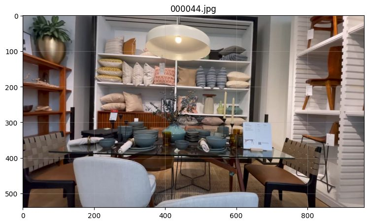
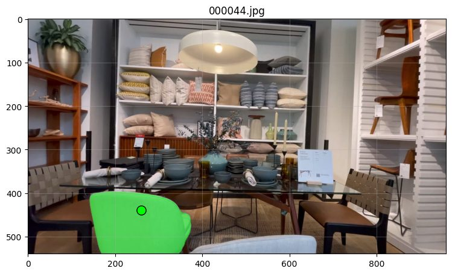
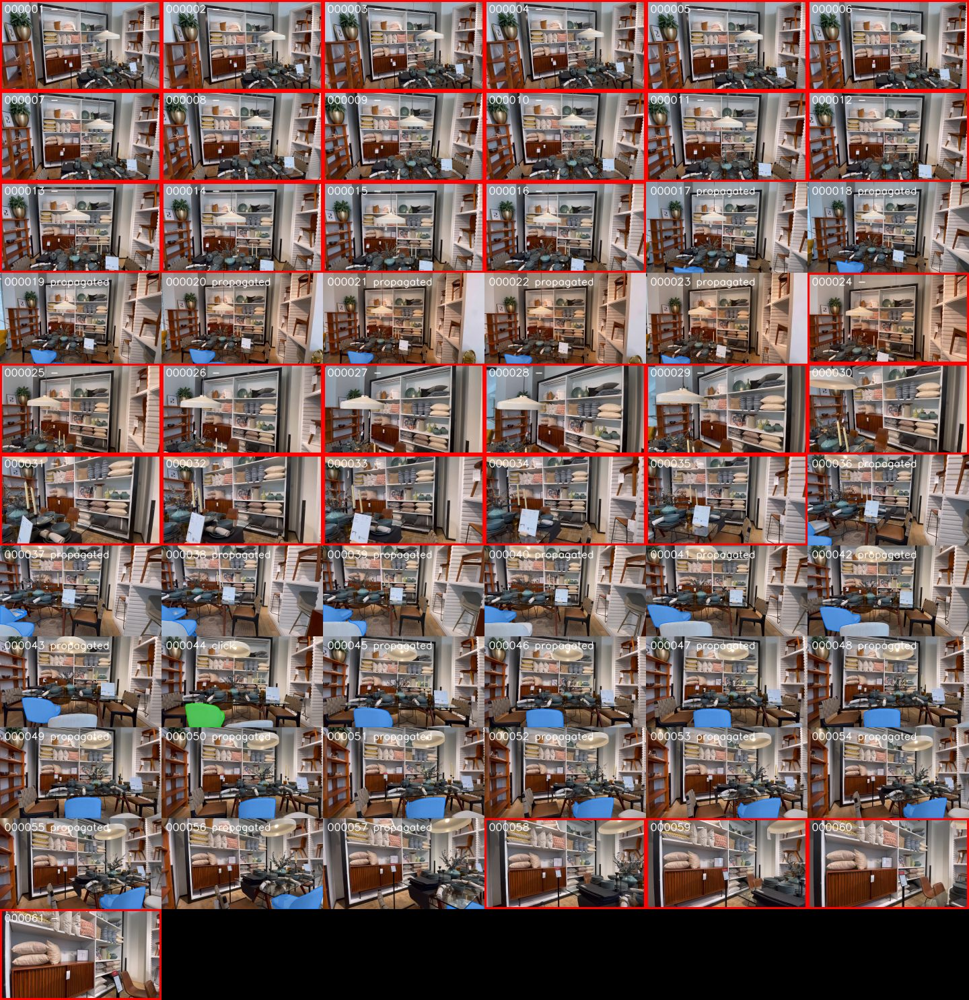
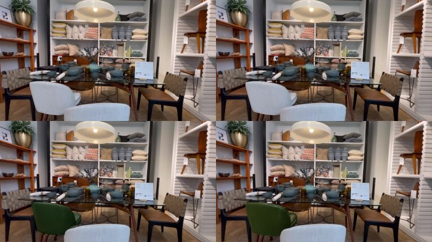

# ML_Work — From a phone video to an editable 3D room (Person A)

Everything the ML side of the project does, in two stages:

* **Week 1 — reconstruct.** Video → frames → camera poses (VGGT *and* GLOMAP, compared) → 3D Gaussian Splatting → `.splat` for the web viewer.
* **Week 2 — edit.** Click an object → SAM 2 mask → track it through the video → diffusion edit (Qwen-Image-2.1) → rebuild the splat (fine-tune vs from scratch) → hand-off package for the backend and viewer.

Everything was run on a Kaggle **T4 ×2**. The backend worker calls these scripts as they are (see [Interfaces](#7-interfaces-for-the-backend-and-the-viewer)), so **do not move `run_pipeline.py`, `stages/`, or `common/`**.

---

## 1. Results at a glance

Test scene: one furniture-showroom room, **61 frames** at 960×540 (1 fps).

### Week 1 — reconstruction

| | VGGT | GLOMAP (chosen) |
|---|---|---|
| frames registered | 61 / 61 | 61 / 61 |
| runtime | 118 s | **38 s** |
| peak VRAM | 11,363 MiB | **543 MiB** |
| sparse points | 300,000 | 11,286 |
| trajectory agreement (Sim(3)-aligned) | RMSE = **0.70 %** of scene extent | |

GLOMAP was picked automatically (`--choose auto`): same frame count, 3× faster, ~20× less VRAM. Details: [`results/week1/pose_comparison.md`](results/week1/pose_comparison.md).

| 3DGS (gsplat, 30,000 iterations) | value |
|---|---|
| training time | 41.1 min (2,466 s) |
| Gaussians (trained → exported) | 1,488,141 → 1,059,412 |
| held-out PSNR / SSIM / LPIPS | **26.78 dB** / **0.887** / **0.064** |
| `scene.ply` / `scene.splat` | 238.4 MB / **32.3 MB** |

Per-stage runtime and VRAM: [`results/week1/VRAM_RUNTIME_TABLE.md`](results/week1/VRAM_RUNTIME_TABLE.md).

### Week 2 — editing (object: the light grey-blue chair → dark green leather)

| Step 1 — pick a frame | Step 2 — one click → mask |
|---|---|
|  |  |
| **Step 3 — track the mask** (SAM 2 video, 29 of 61 frames contain the chair) | **Step 4 — diffusion edit**, original (top) vs. two seeds (bottom) |
|  |  |

| measurement | value |
|---|---|
| SAM 2 click → mask (frame `000044`) | 28,268 px, score 0.98 |
| tracking (SAM 2 video propagation) | 29/61 frames, 21.9 s (1 click + 28 propagated) |
| diffusion (Qwen-Image-2.1, 4-bit, bf16, model offload, 40 steps) | 12,041 MiB peak VRAM, 427 s per generated image, 300 s model load |
| pixels changed **outside** the mask | max 0 on the edit step; 4/255 max after rebuild preparation |

**Rebuild — fine-tune vs from scratch** (`results/week2/rebuild_comparison.md`)

| mode | iterations | time | Gaussians | held-out PSNR | SSIM |
|---|---|---|---|---|---|
| from scratch | 7,000 | 590 s | 1,336,449 | **25.82 dB** | 0.880 |
| fine-tune | 3,000 | **178 s** | 1,649,640 | 10.55 dB | 0.381 |
| *reference: original splat on original frames* | 30,000 | | 1,488,141 | 26.78 dB | 0.887 |

> **Read this before quoting the Week 2 numbers.** From-scratch rebuild works (25.8 dB, close to the original 26.8 dB), but **fine-tune is not usable yet**: 10.6 dB. In the same run, `w2_calibrate` reported *"neither pose set reproduces the photos (PSNR < 15)"* (6.33 dB with the raw COLMAP poses), so the checkpoint and the camera poses probably do not share one coordinate space — the likely cause of the bad fine-tune, though not yet proven. Until that is fixed, hand the viewer the from-scratch scene.
> Also not done yet: the tracking evaluation table (`tools/w2_eval_tracking.py` needs ground-truth labels), and the `both` tracker (SAM 2 + 3D lift); only `sam2` was run.

---

## 2. Output files and links

The raw Kaggle outputs are far too large for git (GitHub rejects files over 100 MB), so they are hosted outside the repo. Small, useful files are committed under [`results/`](results/).

| what | size | where |
|---|---|---|
| Week 1 export (`scene.splat`, `cameras.json`, metrics, manifest) — `demo_export.zip` | 235 MB | [Google Drive](https://drive.google.com/file/d/1pgx7i6GXq14e5epBobckeaAA3MxAdxGs/view?usp=sharing) |
| Week 2 inputs (`demo_week2_inputs.zip`: frames, poses, splat-rendered depth, checkpoint) | 329 MB | _paste link_ |
| Week 2 hand-off for backend + viewer (`handoff_demo.zip`) | 1.04 GB | _paste link_ |
| Edit masks + edited frames (`e1_masks_edited.zip`) | _size_ | _paste link_ |
| Final splat checkpoint `ckpt_29999_rank0.pt` | _size_ | _paste link_ |
| `scene.splat` (committed, loads directly in the viewer) | 32 MB | `results/week1/scene.splat` _(copy it in, see §6)_ |

Each link folder also has a `LARGE_FILES.md` (made by `tools/pack_for_github.py`) with sha256 checksums, so a download can be verified.

---

## 3. Folder layout

```
ML_Work/
├─ run_pipeline.py              Week 1 orchestrator: every stage is its own process (VRAM is freed in between)
├─ stages/                      one script per stage
│  ├─ s1_extract_frames.py      ffmpeg, fps auto (1–4), long side ≤ 960, blur filter
│  ├─ s2a_poses_vggt.py         VGGT, fp16, 32-frame chunks merged with Sim(3)
│  ├─ s2b_poses_glomap.py       GLOMAP (pycolmap 4 or CLI), falls back to incremental SfM if quality checks fail
│  ├─ s3_compare_poses.py       the required VGGT-vs-GLOMAP report; writes scene/
│  ├─ s4_train_3dgs.py          gsplat, 7k quick / 30k full, holds out every 8th frame
│  ├─ s5_export_splat.py        scene.ply → scene.splat, cameras.json, scene_meta.json
│  ├─ s6_prepare_week2.py       saves what Week 2 needs (inputs.json, sparse depth, rendered depth)
│  └─ w2_calibrate / w2_segment / w2_track / w2_edit / w2_rebuild .py     Week 2 stages
├─ common/                      shared code (COLMAP I/O, geometry, VGGT merge, gs I/O, masks, SAM wrapper, progress feed…)
├─ tools/                       reports, hand-off packaging, evaluation, notebook cleaner, size packer
├─ scripts/                     setup_kaggle.sh, make_notebook*.py (regenerate the notebooks)
├─ notebooks/
│  ├─ kaggle_pipeline.ipynb     Week 1 — clean, ready to run
│  ├─ kaggle_week2.ipynb        Week 2 — clean, ready to run
│  └─ executed/                 the two notebooks WITH my outputs (cleaned of progress spam, GitHub-renderable)
├─ results/                     small results: tables (.md), result images, scene.splat
├─ docs/WEEK2_PIPELINE.md       Week 2 design and decisions
├─ tests/                       65 tests, all CPU (synthetic scenes)
├─ requirements.txt
└─ .gitignore                   keeps zips, checkpoints, .ply and workspaces out of git
```

---

## 4. Reproduce

**On your own machine (CPU only):** tests, frame extraction, reports.
```bash
cd ML_Work
pip install -r requirements.txt            # plus ffmpeg on PATH
python -m pytest tests -q                  # 65 passed, 1 skipped
python stages/s1_extract_frames.py --project demo --video room.mp4 --fps auto
```

**On Kaggle (GPU T4 ×2, Internet on):** open `notebooks/kaggle_pipeline.ipynb`, set `REPO` and `VIDEO`, run top to bottom. Then `notebooks/kaggle_week2.ipynb`, which unpacks the Week 1 results (`demo_week2_inputs.zip`) as its input. First run: ~10–20 min of installs (gsplat compiles once).

Single command for Week 1: `python run_pipeline.py --video room.mp4 --method both --train-mode quick` (`--method vggt|glomap`, `--train-mode full`, `--from-stage train`, …).

Week 2 stages, in order, each takes `--project-dir <workspace>/<project> --edit-id e1`:

```bash
python stages/w2_calibrate.py --project-dir $P          # make the checkpoint and the poses agree (required)
python stages/w2_segment.py   --project-dir $P --edit-id e1 --frame 000044.jpg --clicks '[{"x":260,"y":440,"positive":true}]'
python stages/w2_track.py     --project-dir $P --edit-id e1 --tracker sam2      # sam2 | both | lift
python stages/w2_edit.py      --project-dir $P --edit-id e1 --phase reference --prompt "..." --n-seeds 2   # then --phase rest
python stages/w2_rebuild.py   --project-dir $P --edit-id e1 --mode finetune     # or scratch
python tools/make_handoff.py  --project-dir $P --out handoff_demo.zip --no-checkpoint
```

---

## 5. On-disk contract (the backend and Week 2 read exactly this)

```
workspace/<project>/
  video/input.mp4
  frames/images/000001.jpg …      resized + blur-filtered; names equal the names in the COLMAP model
  poses/vggt/, poses/glomap/      each: sparse/0/, points.ply, *_meta.json
  scene/                          images, sparse/0/, chosen.json    ← the chosen pose method; input to 3DGS and Week 2
  gs/gsplat_<iters>/ckpts/*.pt    trained Gaussians
  export/                         scene.ply, scene.splat, cameras.json, scene_meta.json
  metrics/                        per-stage json, pose_comparison.*, progress.jsonl
  week2/                          inputs.json, sparse_depth/, depth/
  edits/<edit-id>/                masks/, edited/, metrics/, a full rebuilt scene (version = edit id)
  manifest.json                   project-relative paths
```
Facts to remember: the COLMAP world is **+y down** (viewer up-vector = (0, −1, 0)); `export/cameras.json` is rewritten in the splat's space by `w2_calibrate` (the original is kept as `cameras_raw_colmap.json`).

---

## 6. Large outputs — what goes where

| Put in git | Host outside git (Drive / Hugging Face / GitHub Release) |
|---|---|
| code, tests, notebooks (cleaned) | any `.zip` from Kaggle (handoff, week2_inputs, e1_masks_edited) |
| `results/**/*.md`, `*.json`, `*.jpg` / `*.png` | `.pt` checkpoints, `scene.ply` (238 MB) |
| `scene.splat` (32 MB, under GitHub's 50 MB warning) | `frames/`, `depth/`, `poses/` folders |

Check what would break a push, and prepare the small part, **without extracting the zip first**:

```bash
python tools/pack_for_github.py --src ~/Downloads/demo_export.zip --dest results/week1/export --max-mb 40
python tools/pack_for_github.py --src ~/Downloads/handoff_demo.zip --dest results/week2/handoff
python tools/pack_for_github.py --src ~/Downloads/e1_masks_edited.zip --dest results/week2/e1 --keep-dir masks
```

It copies the small files, writes `LARGE_FILES.md` (name, size, sha256, empty link column) and prints the totals. Upload the big files, paste the links into `LARGE_FILES.md` and into §2 above.

Make a finished notebook GitHub-friendly (an 8 MB notebook with progress bars will not render):

```bash
python tools/clean_notebook.py week2-done.ipynb notebooks/executed/week2_executed.ipynb
```

---

## 7. Interfaces for the backend and the viewer

**Backend worker** (`backend/worker/kaggle_worker.py --ml-dir …/ML_Work`):

```bash
python run_pipeline.py --video <uploaded.mp4> --root <storage> --project <project_id> \
       --method vggt --train-mode quick --backend-url https://<tunnel> --task-id <task_id>
python stages/w2_segment.py --edit-id E (--frame F --clicks JSON | --add-frames JSON)
python stages/w2_track.py   --edit-id E
python stages/w2_rebuild.py --edit-id E --mode finetune|scratch
```
Progress is POSTed to `/tasks/{id}/progress` as `{status, stage, progress, error}`; `common/progress.py` sends the `W1_WORKER_TOKEN` bearer header when that variable is set (unchanged behaviour from the approved backend change).

**Viewer:** load `export/scene.splat`; `export/cameras.json` has every training camera (`position`, `rotation` = camera-to-world, `fx fy cx cy`, `img_name`); `scene_meta.json` has the bounding box, Gaussian count and up-vector note. For an edited scene use `edits/<id>/export/scene.splat`. If splat rendering fails, `scene/points.ply` is a plain coloured point-cloud fallback.

---

## 8. Troubleshooting (short list)

| Symptom | Fix |
|---|---|
| `VGGT is not installed` | `bash scripts/setup_kaggle.sh vggt && source /kaggle/working/env.sh` |
| CUDA OOM in VGGT | lower `--chunk-size` (16–24); see `metrics/vggt_memory_sweep.json` |
| CUDA OOM in the diffusion edit | `--gen-scale 0.7 --offload model`, 4-bit quantisation; one 4-bit run needs ≈ 12 GB |
| `No global mapper found` | use pycolmap 4 (`setup_kaggle.sh fast`) or install COLMAP ≥ 3.14; or `--method vggt` |
| gsplat first run is very slow | one-off CUDA compile (~5 min); `TORCH_CUDA_ARCH_LIST=7.5` is already set |
| splat is upside down in the viewer | COLMAP is y-down: set up-vector to (0, −1, 0) |
| `w2_calibrate` PSNR < 15 | checkpoint and poses do not match — see the warning box in §1 |
| session about to expire | zip `export/ metrics/ scene/` first (last cells of the notebooks) |

---

## 9. Status and open items

- [x] Week 1 end to end on a real video; GLOMAP vs VGGT experiment; `.splat` exported; 3DGS 26.8 dB held-out.
- [x] Week 2: click → mask → track → diffusion edit → rebuild from scratch → hand-off package.
- [ ] **Fine-tune rebuild** gives 10.6 dB — fix the checkpoint/pose space mismatch found by `w2_calibrate` (§1).
- [ ] Tracking evaluation table (label 10–30 frames in `GT`, run `tools/w2_eval_tracking.py`).
- [ ] Run the `both` tracker (SAM 2 + 3D lift) and compare with `sam2` alone.
- [ ] Diffusion is slow (≈ 7 min per image on a T4 in 4-bit); measure the 8-bit / no-quantisation settings with `--quant`.
